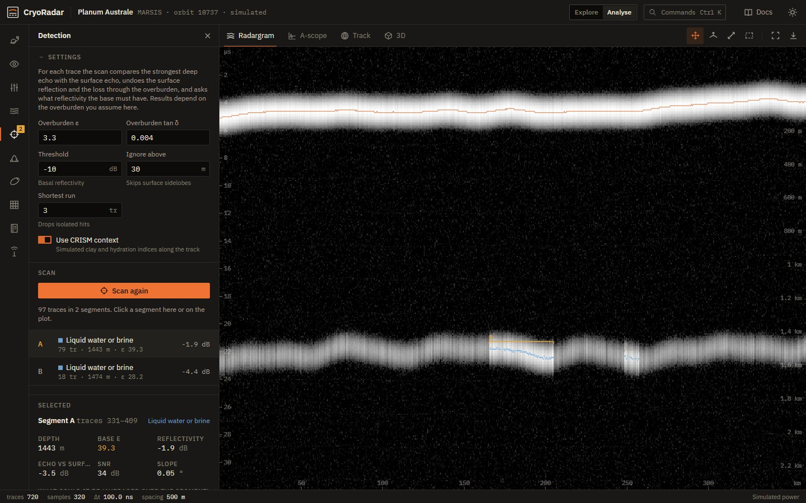
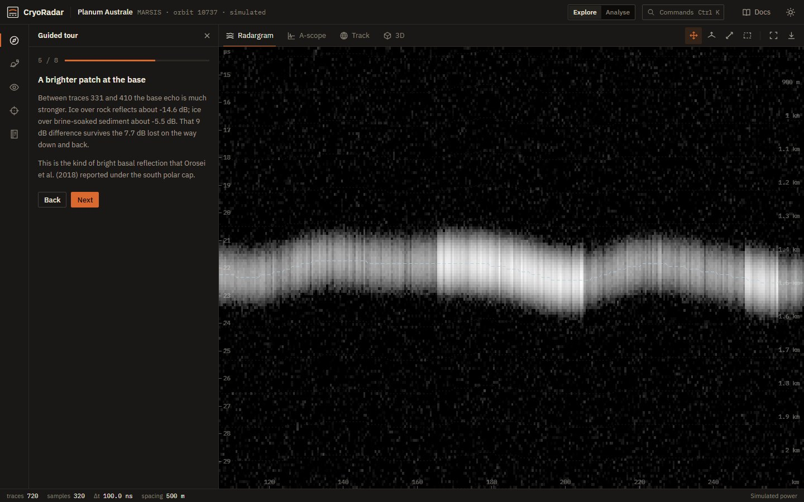
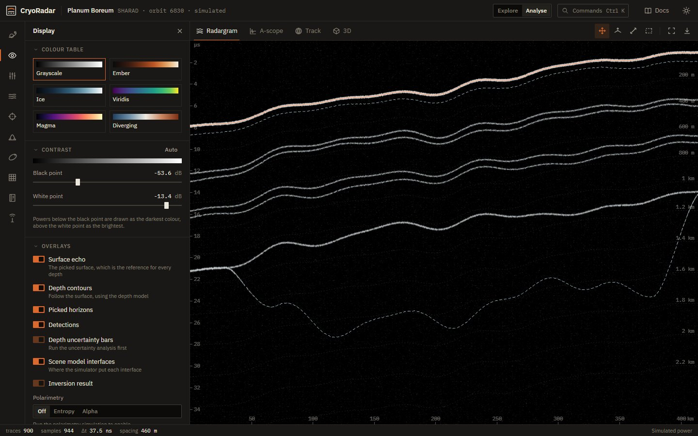
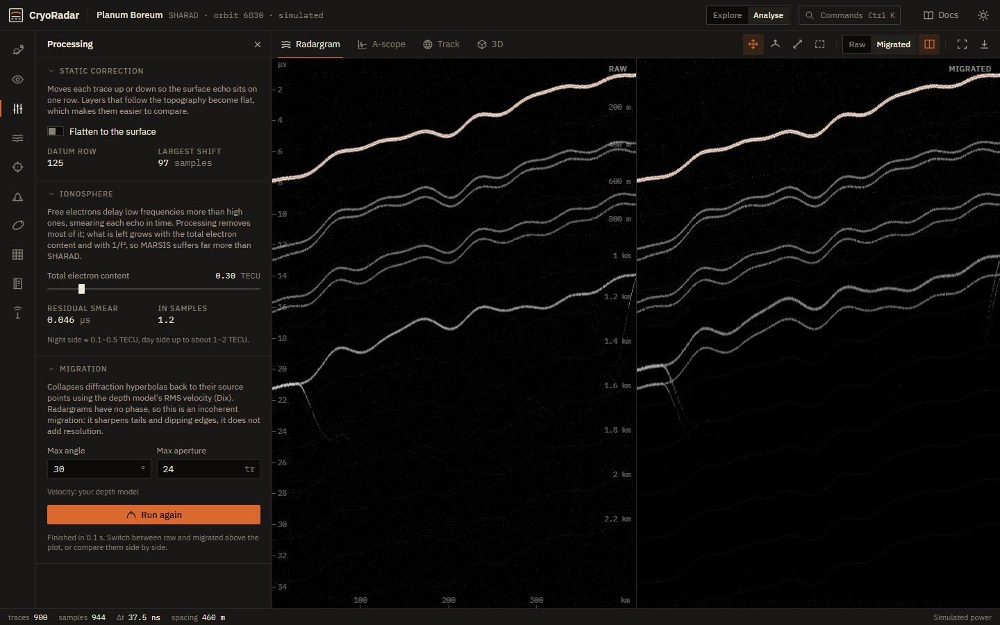
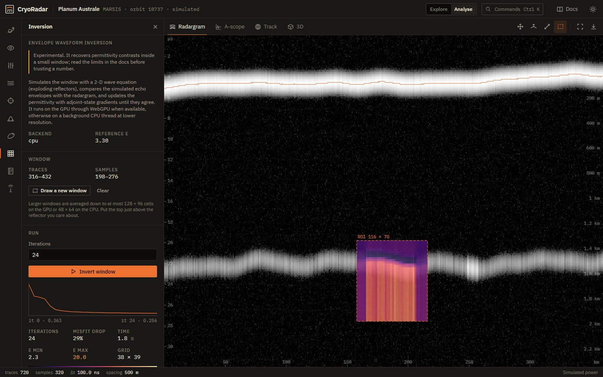

# CryoRadar

A browser tool for looking under the ice of Mars with orbital radar. It reads SHARAD radargrams from NASA's Planetary Data System, simulates MARSIS and SHARAD scenes from layered ice models, converts echo delay to depth, and looks for the unusually bright reflections at the base of the ice that have been argued to be liquid water.

**[Open CryoRadar](https://cyroradar.vercel.app)** · [Documentation](https://cyroradar.vercel.app/docs) · [Changelog](CHANGELOG.md)



## What it does

| | Status |
| --- | --- |
| Load SHARAD tracks from the PDS archive, as browse images or calibrated power | stable |
| Five simulated scenes (south and north polar caps, a debris-covered glacier, two mid-latitude ice deposits) | stable |
| Depth model with picked horizons, Dix RMS velocity and a temperature-dependent ice model | stable |
| Bright basal reflection detection, with water / clay / clutter hypotheses | stable |
| Monte Carlo uncertainty on depth and basal permittivity | stable |
| Static correction, ionospheric smear (simulated scenes), incoherent Kirchhoff migration | stable |
| Envelope waveform inversion, WebGPU with a CPU fallback | experimental |
| Polarimetric decompositions and CRISM context | simulated, labelled as such |
| A-scope, track map with polar projection, 3D curtain view | stable |
| Sessions, shareable links, PNG / CSV / JSON / PDF export, offline use | stable |

Every calculation is written up in the [physics reference](https://cyroradar.vercel.app/docs/physics), and the [limits page](https://cyroradar.vercel.app/docs/limitations) lists what has and has not been checked.

## Running it locally

You need Node 20.19 or newer.

```bash
git clone https://github.com/SpaceEngineerSS/cyroradar.git
cd cyroradar
npm install
npm run dev
```

The dev server proxies `/pds-data` to the PDS archive, so loading real tracks works locally. `npm run build && npm run preview` serves the production build with the same proxy.

| Command | |
| --- | --- |
| `npm test` | physics and analysis tests (Vitest) |
| `npm run test:coverage` | the same, with a coverage report |
| `npm run lint` | ESLint, with type-aware rules on the core code |
| `npm run typecheck` | TypeScript, no emit |
| `npm run screenshots` | regenerates `public/media`, the icons and the social image from a running preview |

## How it is put together

React 19 and TypeScript on Vite, Tailwind CSS 4, Zustand for state, three.js for the 3D view, Motion for interface transitions, jsPDF for reports, MDX and KaTeX for the docs. The radargram is drawn with WebGL 2 and every heavy calculation runs in a worker. The [architecture page](https://cyroradar.vercel.app/docs/architecture) goes through it.

```
src/
  core/       physics, analysis, data pipeline, exports (no React)
  workers/    compute worker and job runner
  store/      application state
  features/   the interface, one folder per area
  ui/         buttons, fields, icons
  docs/       documentation pages and figures
scripts/      screenshot and icon generator
```

## Screens

| | |
| --- | --- |
|  |  |
| Guided tour | Depth model and scene interfaces |
|  |  |
| Migration, raw against migrated | Waveform inversion (experimental) |

## Data

Archive data come from the US SHARAD radargram collection, MRO-M-SHARAD-5-RADARGRAM-V2.0 (B. A. Campbell, producer), served by the PDS Geosciences Node and searched through the ODE REST API. The simulated scenes are built from published layer models; their sources are listed in the app and in the [references](https://cyroradar.vercel.app/docs/references).

## Citing

If CryoRadar was useful in your work, please cite it using [`CITATION.cff`](CITATION.cff) (GitHub's "Cite this repository" button reads it).

## Contributing

Bug reports and corrections are welcome, particularly from people who work with radar sounder data. See [CONTRIBUTING.md](CONTRIBUTING.md).

## License

MIT. See [LICENSE](LICENSE).

Made by [Mehmet Gümüş](https://github.com/SpaceEngineerSS).
